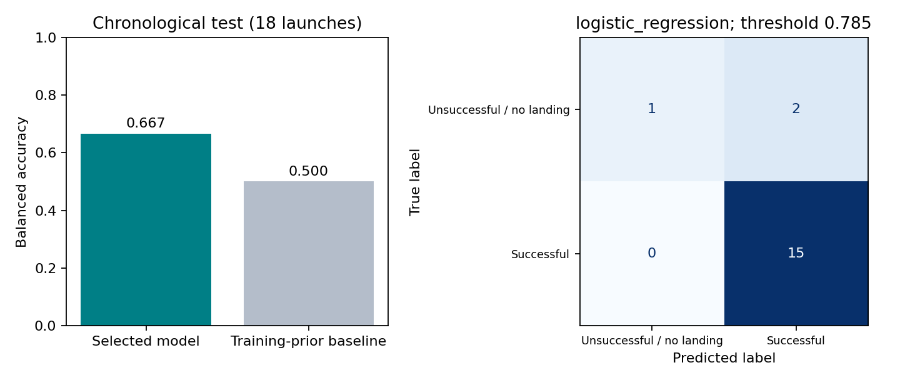

# Falcon 9 landing outcomes

**How much can a small launch-history dataset tell us about first-stage landing outcomes?** An IBM capstone extended with reproducible model selection, a chronological holdout, baseline comparisons and a Dash explorer.

Jihad Boussata · Python · scikit-learn · SQL/EDA coursework · Plotly Dash



## Result and uncertainty

| Chronological test | Selected logistic model | Training-prior baseline |
| --- | --- | --- |
| Correct launches | 16 / 18 | 15 / 18 |
| Accuracy | 88.9% | 83.3% |
| Balanced accuracy | 0.667 | 0.500 |
| ROC AUC | 0.667 | 0.500 |

This is a **90-launch 2010–2020 course snapshot**, not current SpaceX coverage. Test contains only 18 launches, including three unsuccessful outcomes. The selected model's exact binomial 95% accuracy interval is approximately 65.3%–98.6%. Its one-launch advantage over the baseline is insufficient evidence of a reliable forecasting improvement; chronological dependence further limits the binomial interpretation.

## Reproduce

Use Python 3.12, activate a virtual environment, then run from this directory:

```bash
python -m pip install -r requirements.txt
python -m unittest discover -s tests -v
python -m spacex.train
```

The source snapshot is already in `data/`. Fresh metrics, predictions, selection tables and the figure are written to `results/`. For the dashboard:

```bash
python -m pip install -r requirements-dashboard.txt
python spacex_dash_app.py
```

Open `http://127.0.0.1:8050`. Site filters and a full-range payload slider cover all known payload masses; five unknown payloads are excluded from the scatter plot.

## What changed in the evaluation

- Split ordered launches into 54 training, 18 validation and 18 test records. Hyperparameter search uses expanding training windows, with a one-launch gap.
- Fit imputation, scaling and encoding inside each training fold; the course notebook previously scaled before splitting.
- Restore the five payloads previously filled with the upstream global mean to missing, then learn fold-specific medians.
- Use launch configuration features; exclude the outcome string, target, landing-pad identifier, core serial and API-snapshot reuse count.
- Compare logistic regression, SVM, decision trees and KNN. Select the model and F1 decision threshold on validation, then freeze both before test.
- Compare with a train-prior baseline and report minority-class behavior and small-sample uncertainty.

## Repository guide

| Path | Purpose |
| --- | --- |
| spacex/ | Reproducible training and evaluation |
| spacex_dash_app.py | Historical-data explorer |
| data/ | Original course snapshots and data documentation |
| results/ | Authoritative portfolio results |
| tests/ | Preprocessing and feature-availability checks |
| archive/ | Original course notebooks and older outputs; historical context only |
| docs/ | Protocol, limitations and change record |

## Interpretation and attribution

The label combines landing failure with records where there was no successful recovery attempt. Grid fins and legs partly encode mission intent, so this is not a physics model of landing reliability. The upstream API extraction is a retrospective snapshot; historical point-in-time availability is not fully verified. Generalization to later launch generations is unknown.

The repository originated in the **Applied Data Science Capstone**, part of the **IBM Data Science Professional Certificate**. Course templates and source notices are preserved in the archive. Data originated from the SpaceX API and Wikipedia exercises used by IBM. New portfolio implementation is MIT licensed; upstream material retains its notices. See [data provenance](data/README.md), [methodology](docs/METHODOLOGY.md) and [changes](docs/CHANGES.md).
